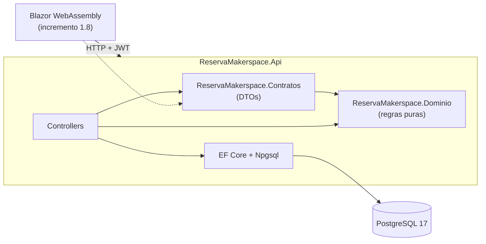

# Reserva de Equipamentos de Makerspace

Em parques tecnológicos como o Itec Park, onde trabalhei como bolsista, a cortadora a laser, as impressoras 3D e o scanner 3D ficam ocupados o dia inteiro. Com o controle em planilha, as reservas conflitam (há mais de uma máquina do mesmo tipo e ninguém sabe qual foi marcada), gente sem treinamento usa as máquinas e a manutenção não bloqueia a agenda.

Este projeto é uma API de reservas com regras claras e testadas (.NET 10, ASP.NET Core, EF Core e PostgreSQL), com uma interface em Blazor prevista para depois.

## Estado

Roteiro em `docs/specs/2026-11-24-c1-reserva-makerspace-design.md` (§9).

- **1.1 Esqueleto: concluído.** Solução, `Intervalo` (primeira regra do domínio), PostgreSQL com a primeira migração, `/saude`, erros em ProblemDetails, OpenAPI com Scalar, Docker, Compose e CI.
- **1.2 Login e papéis: concluído.** Cadastro, login com JWT de 60 min, `/me`, papéis cumulativos (Usuário, Equipe e Coordenação), primeira Coordenação por variáveis de ambiente, e `GET /usuarios` e `PUT /usuarios/{id}/papel` para a Coordenação. Toda rota exige login, menos as públicas.
- **1.3 Tipos e máquinas: concluído.** `GET`, `POST` e `PUT` de tipos de equipamento e de máquinas (a Coordenação cadastra e altera; qualquer pessoa logada consulta, inclusive as máquinas inativas), com nome único sem diferenciar maiúsculas e minúsculas. No Compose e no ambiente de desenvolvimento, a API sobe com dados de exemplo do Itec Park (ADR 0004). O CI passou para as versões das actions que rodam no Node 24, e o Dockerfile usa o mesmo SDK do `global.json`.
- 1.4 a 1.10: treinamentos, reservas, desmarcação, manutenção, Blazor e deploy.

## Como rodar

Precisa do Docker.

```bash
cp .env.example .env
# edite o .env e preencha:
#   POSTGRES_PASSWORD   senha do banco
#   JWT_CHAVE           chave dos tokens (gere com: openssl rand -base64 48)
#   COORDENACAO_EMAIL e COORDENACAO_SENHA   a primeira Coordenação (senha com 15+ caracteres)
#   EXEMPLO_SENHA       senha das três pessoas de exemplo (15+ caracteres; opcional)
docker compose up --build
```

- Saúde da API: <http://localhost:5080/saude> (200 `Healthy`, ou 503 se o banco cair)
- Documentação interativa: <http://localhost:5080/scalar> (o OpenAPI fica em `/openapi/v1.json`)
- PostgreSQL no host: porta `5433` (a `5432` fica livre para outro banco)

Sem a senha do banco ou sem a chave no `.env`, o Compose para com "Defina POSTGRES_PASSWORD no .env" ou "Defina JWT_CHAVE no .env". Sem `COORDENACAO_EMAIL` e `COORDENACAO_SENHA`, a API sobe sem Coordenação (e avisa no log): ninguém consegue definir papéis.

**Dados de exemplo.** O Compose sobe com 4 tipos de equipamento, 6 máquinas (o Scanner 3D vem inativo, para mostrar esse caso) e uma pessoa em cada papel. Todas usam a senha de `EXEMPLO_SENHA`, que fica só no seu `.env`:

| Pessoa | E-mail | Papel |
|---|---|---|
| Ana Aluna | `aluna@makerspace.example` | Usuário |
| Beto Bolsista | `bolsista@makerspace.example` | Equipe |
| Carla Coordenadora | `coordenadora@makerspace.example` | Coordenação |

Sem `EXEMPLO_SENHA`, entram só os tipos e as máquinas. Os dados de exemplo só são criados, nunca alterados: subir de novo não duplica nada, e uma máquina renomeada ou uma pessoa rebaixada continuam como estão. Fora do Compose, a opção `DadosDeExemplo:Aplicar` vem desligada (só o `appsettings.Development.json` a liga).

**Entrar no Scalar:** faça `POST /auth/login` com o e-mail e a senha da Coordenação, copie o `token` da resposta e cole no campo *Bearer* de autenticação do Scalar. Dali em diante, as chamadas já vão com o token. Ele vale 60 minutos.

Rotas públicas: `POST /auth/cadastro` (cria sempre um Usuário), `POST /auth/login`, `/saude`, `/openapi/v1.json` e `/scalar`. Todas as outras exigem login.

Rotas de tipos e máquinas (o `GET` vale para qualquer pessoa logada; o `POST` e o `PUT`, só para a Coordenação):

| Rota | O que faz |
|---|---|
| `GET /tipos-de-equipamento`, `GET /tipos-de-equipamento/{id}` | Lista (por nome) e consulta um tipo |
| `POST /tipos-de-equipamento`, `PUT /tipos-de-equipamento/{id}` | Cria e altera (`nome` e `duracaoMaximaPessoalMinutos`, de 15 a 10 080) |
| `GET /equipamentos`, `GET /equipamentos/{id}` | Lista (por tipo e nome) e consulta uma máquina, inclusive as inativas |
| `POST /equipamentos`, `PUT /equipamentos/{id}` | Cria e altera (`nome`, `tipoId` e `ativo`) |

Não há `DELETE`: desativar uma máquina (`ativo: false`) não apaga o histórico. O `PUT` substitui o recurso inteiro, então todos os campos são obrigatórios. Nome repetido responde 409, e um `tipoId` que não existe, 400.

## Como testar

```bash
dotnet test
```

Com o Docker aberto: os testes de integração sobem um PostgreSQL 17 real em container (Testcontainers). Os testes de unidade não usam Docker.

## Arquitetura



- `Dominio` guarda as regras (hoje, o `Intervalo` semiaberto, o `Papel`, o tipo de equipamento e a máquina) sem depender de banco nem de web, e por isso tem testes de unidade rápidos, sem Docker.
- `Contratos` guarda os DTOs de pedido e resposta, compartilhados com o Blazor. Referencia só o `Dominio`.
- `Api` expõe as rotas, autentica (Identity e JWT), aplica as migrations na subida e responde os erros em ProblemDetails, com títulos em português.
- `Testes.Integracao` sobe a API inteira (`WebApplicationFactory`) contra um PostgreSQL real em container.

## Decisões

- [0001. Estrutura da solução](docs/decisoes/0001-estrutura-da-solucao.md)
- [0002. Migrations na subida da API](docs/decisoes/0002-migrations-na-subida-da-api.md)
- [0003. Login com Identity e JWT](docs/decisoes/0003-login-com-identity-e-jwt.md)
- [0004. Dados de exemplo na subida](docs/decisoes/0004-dados-de-exemplo-na-subida.md)

## Roteiro de entrevista

- **Por que testar contra um PostgreSQL real, e não um banco em memória?** A primeira migração cria a extensão `btree_gist`, que é a base da restrição que vai impedir reservas sobrepostas no próprio banco. Um banco em memória não tem isso. O Testcontainers sobe o mesmo PostgreSQL 17 do Compose.
- **Por que o `Intervalo` é semiaberto e usa `DateTimeOffset`?** Uma reserva que termina às 10:00 não pode conflitar com outra que começa às 10:00. E a comparação é entre instantes, não entre relógios locais: um teste confere `10:00-03:00` contra `13:30Z`.
- **O que acontece quando falta configuração ou o banco cai?** Sem a connection string, a API não sobe e diz qual variável configurar. Com o banco fora do ar, `/saude` responde 503 em segundos. Sem a senha no `.env`, o Compose nem sobe o banco.
- **Por que não a Clean Architecture completa?** Neste tamanho de domínio, várias camadas só repassariam chamadas. Separei o que importa testar, que são as regras (ver o ADR 0001).
- **Aplicar migrations na subida não é arriscado?** Com uma instância, não. Com várias, a migração iria para um passo próprio do deploy (ver o ADR 0002).
- **Como os segredos ficam fora do repositório?** O `.env` é ignorado, o `.env.example` vai sem senha nem chave, a API recebe a senha do banco, a chave do JWT e a senha da Coordenação por variável de ambiente, e a imagem roda com um usuário sem privilégio. Sem a chave (ou com menos de 32 caracteres), a API não sobe e diz o que configurar.
- **Por que o papel não vai dentro do token?** Porque um token vale 60 minutos, e uma Coordenação rebaixada continuaria agindo como Coordenação até ele vencer, podendo até se promover de novo. A API relê o papel no banco a cada pedido: custa uma consulta pela chave primária e faz promover e rebaixar valerem na hora (ver o ADR 0003).
- **Como se garante que sempre sobra uma Coordenação?** A troca de papel roda numa transação que trava as linhas das Coordenações (`SELECT … FOR UPDATE`, em ordem de id) antes de contar. Sem a trava, duas Coordenações rebaixando uma à outra ao mesmo tempo passariam as duas na contagem. Um teste dispara os dois pedidos juntos, e removi a trava para ver o teste falhar.
- **Por que toda rota exige login por padrão?** Uma `FallbackPolicy` exige usuário autenticado, e só as rotas públicas são marcadas. Um controller novo sem `[Authorize]` já nasce protegido, e um teste lista as rotas anônimas e confere que são só as esperadas.
- **O que impede alguém de se cadastrar como Coordenação?** O pedido de cadastro não tem campo de papel (um `"papel"` extra no JSON é ignorado), e a primeira Coordenação vem de variáveis de ambiente. Se o e-mail dela já foi cadastrado por outra pessoa, a API não promove essa conta e a subida falha.

- **Como o nome fica único sem diferenciar maiúsculas e minúsculas?** "Impressora FDM 2" e "impressora fdm 2" são o mesmo nome, mas os acentos contam. Uso uma colação ICU não determinística (`und-u-ks-level2`) nas colunas `nome`, com índice único. Um `UNIQUE` comum diferenciaria a caixa, e um índice em `lower(nome)` seria fácil de esquecer numa consulta.
- **De onde vem o 409 do nome repetido?** Do próprio índice único: a API grava e traduz a violação (`PostgresException` 23505, pelo nome do índice) em 409. Consultar antes de gravar deixaria uma janela entre conferir e gravar, e dois pedidos simultâneos com o mesmo nome dariam 500. Um teste dispara os dois juntos e confere um 201 e um 409.
- **Por que os dados de exemplo só criam e não vêm numa migração?** Uma migração levaria os dados para a produção, e não gera o hash da senha. A classe de exemplo roda na subida, só quando a configuração manda, usa o `UserManager` e nunca altera nem apaga: uma máquina renomeada ou uma pessoa rebaixada não voltam ao que eram (ver o ADR 0004).
- **Por que o `PUT` exige todos os campos?** Se `ativo` fosse opcional, um `PUT` feito só para renomear reativaria sem querer uma máquina inativa. Com o recurso inteiro no pedido, cada campo é uma decisão explícita.

## Próximos passos

- 1.4: treinamentos (quem pode usar cada tipo de equipamento).
- 1.10: limite de tentativas de login (*rate limiter* por IP), junto do deploy.

## Como foi feito

Desenvolvido com apoio de ferramentas de IA, com as decisões e a revisão feitas por mim.
