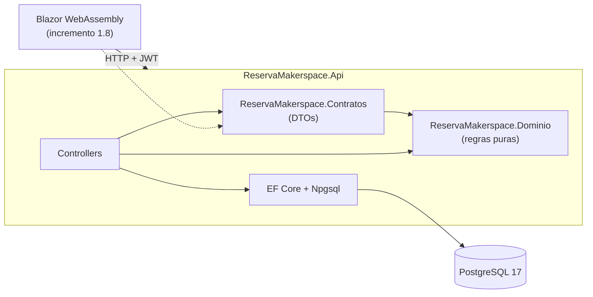

# Reserva de Equipamentos de Makerspace

Em parques tecnológicos como o Itec Park, onde trabalhei como bolsista, a cortadora a laser, as impressoras 3D e o scanner 3D ficam ocupados o dia inteiro. Com o controle em planilha, as reservas conflitam (há mais de uma máquina do mesmo tipo e ninguém sabe qual foi marcada), gente sem treinamento usa as máquinas e a manutenção não bloqueia a agenda.

Este projeto é uma API de reservas com regras claras e testadas (.NET 10, ASP.NET Core, EF Core e PostgreSQL), com uma interface em Blazor prevista para depois.

## Estado

Roteiro em `docs/specs/2026-11-24-c1-reserva-makerspace-design.md` (§9).

- **1.1 Esqueleto: concluído.** Solução, `Intervalo` (primeira regra do domínio), PostgreSQL com a primeira migração, `/saude`, erros em ProblemDetails, OpenAPI com Scalar, Docker, Compose e CI.
- **1.2 Login e papéis: concluído.** Cadastro, login com JWT de 60 min, `/me`, papéis cumulativos (Usuário, Equipe e Coordenação), primeira Coordenação por variáveis de ambiente, e `GET /usuarios` e `PUT /usuarios/{id}/papel` para a Coordenação. Toda rota exige login, menos as públicas.
- **1.3 Tipos e máquinas: concluído.** `GET`, `POST` e `PUT` de tipos de equipamento e de máquinas (a Coordenação cadastra e altera; qualquer pessoa logada consulta, inclusive as máquinas inativas), com nome único sem diferenciar maiúsculas e minúsculas. No Compose e no ambiente de desenvolvimento, a API sobe com dados de exemplo do Itec Park (ADR 0004). O CI passou para as versões das actions que rodam no Node 24, e o Dockerfile usa o mesmo SDK do `global.json`.
- **1.4 Treinamentos: concluído.** A Equipe e a Coordenação registram e revogam treinamentos (pessoa por tipo de equipamento, válidos por 12 meses); renovar é registrar outro, e o histórico fica. Cada pessoa vê os seus em `GET /me/treinamentos`. A situação (válido, vencido ou revogado) é calculada pelo relógio da API, que vale também na validação do JWT (ADR 0005). Os dados de exemplo ganharam treinamentos.
- **1.5 Reservas, o núcleo: concluído.** Qualquer pessoa logada reserva uma máquina (`POST /reservas`) com as regras da §4.2 da spec: treinamento válido até o fim da reserva, sem sobreposição (mesmo com pedidos simultâneos), duração máxima do tipo, até 7 dias de antecedência e no máximo 2 reservas pessoais ativas. A Equipe e a Coordenação também fazem demandas do parque (até 30 dias, sem duração máxima). Cada pessoa vê e cancela as suas, e a Equipe lista as de todos. Revogar um treinamento cancela as reservas futuras da pessoa no tipo, e uma máquina com reservas futuras não é desativada. A concorrência está no ADR 0006.
- **1.6 Disponibilidade, agenda e desmarcação: concluído.** `GET /disponibilidade` lista as máquinas livres de um tipo num intervalo, e `GET /equipamentos/{id}/agenda` mostra as reservas de uma máquina numa janela de até 31 dias (o nome de quem reservou só aparece para a Equipe; o Usuário o vê nas reservas dele). A Equipe e a Coordenação podem desmarcar reservas pessoais para encaixar uma demanda do parque, com o campo `motivoDesmarcacao` do `POST /reservas` e as 4 travas da spec, na mesma transação da criação. Todo 409 de agenda traz também as máquinas livres. As decisões estão no ADR 0007.
- **1.7 Manutenção: concluído.** A Equipe e a Coordenação registram uma manutenção numa máquina (`POST /equipamentos/{id}/manutencoes`), que cancela toda reserva ativa que cruze o intervalo (`CanceladaPorManutencao`, inclusive a em andamento e as das duas finalidades) e bloqueia reservas novas. Uma manutenção não se sobrepõe a outra, e a Equipe pode encerrá-la antes do fim. A manutenção aparece na agenda (`manutencoes`), na consulta de máquinas livres, na regra de conflito do `POST /reservas` e na trava "manutenção não se desmarca". Com isso a API está completa. As decisões estão no ADR 0008.
- 1.8 a 1.10: Blazor e deploy.

## Como rodar

Precisa do Docker.

```bash
cp .env.example .env
# edite o .env e preencha:
#   POSTGRES_PASSWORD   senha do banco
#   JWT_CHAVE           chave dos tokens (gere com: openssl rand -base64 48)
#   COORDENACAO_EMAIL e COORDENACAO_SENHA   a primeira Coordenação (senha com 15+ caracteres)
#   EXEMPLO_SENHA       senha das três pessoas de exemplo (15+ caracteres; opcional)
docker compose up --build
```

- Saúde da API: <http://localhost:5080/saude> (200 `Healthy`, ou 503 se o banco cair)
- Documentação interativa: <http://localhost:5080/scalar> (o OpenAPI fica em `/openapi/v1.json`)
- PostgreSQL no host: porta `5433` (a `5432` fica livre para outro banco)

Sem a senha do banco ou sem a chave no `.env`, o Compose para com "Defina POSTGRES_PASSWORD no .env" ou "Defina JWT_CHAVE no .env". Sem `COORDENACAO_EMAIL` e `COORDENACAO_SENHA`, a API sobe sem Coordenação (e avisa no log): ninguém consegue definir papéis.

**Dados de exemplo.** O Compose sobe com 4 tipos de equipamento, 6 máquinas (o Scanner 3D vem inativo, para mostrar esse caso) e uma pessoa em cada papel. Todas usam a senha de `EXEMPLO_SENHA`, que fica só no seu `.env`:

| Pessoa | E-mail | Papel |
|---|---|---|
| Ana Aluna | `aluna@makerspace.example` | Usuário |
| Beto Bolsista | `bolsista@makerspace.example` | Equipe |
| Carla Coordenadora | `coordenadora@makerspace.example` | Coordenação |

Os treinamentos de exemplo (as datas são relativas ao momento da subida) mostram as três situações:

| Pessoa | Treinamentos |
|---|---|
| Ana Aluna | Impressora 3D FDM (válido, há 2 meses), Cortadora a laser (vencido, há 13 meses, renovação pendente) e Impressora 3D de resina (revogado há 7 dias, "Descarte de resina fora do recipiente.") |
| Beto Bolsista | os 4 tipos (válidos, há 6 meses) e um registro antigo de Impressora 3D FDM (vencido, há 18 meses, o histórico antes da renovação) |
| Carla Coordenadora | Cortadora a laser (válido, há 1 mês) |

As reservas de exemplo (horas cheias de Brasília, contadas a partir do dia da subida) mostram as situações e as duas finalidades:

| Pessoa | Máquina | Quando | Finalidade e situação |
|---|---|---|---|
| Ana Aluna | Impressora FDM 1 | amanhã, 9h às 13h | Pessoal, "Suporte de celular", ativa |
| Ana Aluna | Impressora FDM 3 | ontem, 14h às 18h | Pessoal, ativa (já passou: o histórico) |
| Ana Aluna | Impressora de resina | há 5 dias, 10h às 12h | Pessoal, cancelada pela Equipe ("Treinamento revogado", pelo Beto, há 7 dias) |
| Ana Aluna | Impressora FDM 2 | depois de amanhã, 10h às 14h | Pessoal, cancelada pela própria Ana |
| Beto Bolsista | Cortadora a laser | amanhã, 14h às 18h | Demanda do parque, solicitante "Prof. Daniel (TCC de Engenharia)", ativa |
| Beto Bolsista | Impressora de resina | daqui a 3 dias, 8h às 16h | Demanda do parque, ativa |
| Carla Coordenadora | Cortadora a laser | daqui a 2 dias, 10h às 11h | Pessoal, ativa |

A Ana fica com uma reserva pessoal futura, e assim dá para demonstrar mais uma antes do limite de 2.

Sem `EXEMPLO_SENHA`, entram só os tipos e as máquinas. Os treinamentos e as reservas de exemplo só entram se o banco ainda não tiver nenhum treinamento (ou nenhuma reserva), e só para as pessoas e as máquinas que existirem. Como as datas são contadas a partir da subida que os criou, num banco que dura meses elas envelhecem: o "válido, há 2 meses" um dia vence, e as reservas de "amanhã" um dia ficam no passado. Os dados de exemplo só são criados, nunca alterados: subir de novo não duplica nada, e uma máquina renomeada ou uma pessoa rebaixada continuam como estão. Fora do Compose, a opção `DadosDeExemplo:Aplicar` vem desligada (só o `appsettings.Development.json` a liga).

**Entrar no Scalar:** faça `POST /auth/login` com o e-mail e a senha da Coordenação, copie o `token` da resposta e cole no campo *Bearer* de autenticação do Scalar. Dali em diante, as chamadas já vão com o token. Ele vale 60 minutos.

Rotas públicas: `POST /auth/cadastro` (cria sempre um Usuário), `POST /auth/login`, `/saude`, `/openapi/v1.json` e `/scalar`. Todas as outras exigem login.

Rotas de tipos e máquinas (o `GET` vale para qualquer pessoa logada; o `POST` e o `PUT`, só para a Coordenação):

| Rota | O que faz |
|---|---|
| `GET /tipos-de-equipamento`, `GET /tipos-de-equipamento/{id}` | Lista (por nome) e consulta um tipo |
| `POST /tipos-de-equipamento`, `PUT /tipos-de-equipamento/{id}` | Cria e altera (`nome` e `duracaoMaximaPessoalMinutos`, de 15 a 10 080) |
| `GET /equipamentos`, `GET /equipamentos/{id}` | Lista (por tipo e nome) e consulta uma máquina, inclusive as inativas |
| `POST /equipamentos`, `PUT /equipamentos/{id}` | Cria e altera (`nome`, `tipoId` e `ativo`) |

Não há `DELETE`: desativar uma máquina (`ativo: false`) não apaga o histórico. O `PUT` substitui o recurso inteiro, então todos os campos são obrigatórios. Nome repetido responde 409, e um `tipoId` que não existe, 400.

Rotas de treinamentos:

| Rota | Quem | O que faz |
|---|---|---|
| `POST /treinamentos` | Equipe | Registra `{ usuarioId, tipoId }`; vale 12 meses a partir do registro. Ninguém registra o próprio (422); pessoa ou tipo inexistente, 400 |
| `GET /treinamentos`, `GET /treinamentos/{id}` | Equipe | Lista (filtro opcional `?usuarioId=`) e consulta um treinamento |
| `POST /treinamentos/{id}/revogacao` | Equipe | Revoga com `{ motivo }` (até 500 caracteres); revoga também os outros ainda válidos da pessoa no tipo. Já revogado ou vencido, 409 |
| `GET /me/treinamentos` | Qualquer pessoa logada | Só os treinamentos da própria pessoa, com a situação, quem registrou e, se houver, quem revogou e por quê |

"Equipe" vale também para a Coordenação. Não há `PUT` nem `DELETE`: o histórico não se apaga, e revogar é a única mudança. Revogar também cancela, na mesma transação, as reservas ativas da pessoa nas máquinas do tipo que ainda não começaram (`CanceladaPelaEquipe`, motivo "Treinamento revogado"); a reserva em andamento continua, e parar a máquina na hora é uma manutenção (1.7).

Rotas de reservas:

| Rota | Quem | O que faz |
|---|---|---|
| `POST /reservas` | Qualquer pessoa logada | Reserva `{ equipamentoId, inicio, fim, finalidade, solicitante?, descricao?, motivoDesmarcacao? }` e responde 201 com `Location`. O operador é sempre quem pede. `finalidade` é `ProjetoPessoal` ou `DemandaDoParque` (esta só para a Equipe e a Coordenação; o `solicitante` e o `motivoDesmarcacao` só nela, e o motivo tem até 500 caracteres) |
| `GET /reservas/{id}` | O dono ou a Equipe | Consulta uma reserva; a de outra pessoa responde 403 |
| `GET /me/reservas` | Qualquer pessoa logada | As próprias reservas, inclusive as canceladas e o motivo, do início mais recente para o mais antigo |
| `POST /reservas/{id}/cancelamento` | Só o dono | Cancela, sem corpo, antes do início (`CanceladaPeloDono`). Já cancelada ou já começada, 409; a Equipe também recebe 403 (a reserva de outra pessoa só sai por uma desmarcação, no `POST /reservas`) |
| `GET /reservas` | Equipe | Lista as de todos, com os filtros opcionais `?usuarioId=` e `?equipamentoId=` |

Os horários precisam trazer o fuso (`2026-12-01T10:00:00-03:00` ou `...Z`): sem ele a resposta é 400, porque o .NET leria o horário no fuso do servidor, que muda de máquina para máquina. A API grava e devolve em UTC. A ordem dos códigos de erro de `POST /reservas`: formato (400), papel (403), regras (422) e, por último, a agenda (409, com a lista `conflitos` de cada reserva que cruza, no formato da agenda, e `maquinasLivres`; os campos extras que a Equipe vê estão no parágrafo da agenda, abaixo). Os limites são inclusivos: começar agora, durar exatamente a máxima do tipo, começar em exatamente 7 dias e acabar exatamente no último instante do treinamento são aceitos. Desativar ou trocar o tipo de uma máquina com reservas ativas que ainda não acabaram (`PUT /equipamentos/{id}`) responde 409 com a mesma lista `conflitos`; renomear e reativar continuam livres.

Rotas de disponibilidade e agenda (qualquer pessoa logada):

| Rota | O que faz |
|---|---|
| `GET /disponibilidade?tipoId=&inicio=&fim=` | As máquinas **ativas** do tipo sem reserva nem manutenção ativa que cruze `[inicio, fim)`, em ordem de nome, no formato do `GET /equipamentos`. Sem nenhuma livre, a lista vem vazia. Sem limite de janela. `tipoId` que não existe, 400 |
| `GET /equipamentos/{id}/agenda?de=&ate=` | `{ equipamentoId, equipamentoNome, de, ate, reservas, manutencoes }`: as reservas e as manutenções ativas que cruzam `[de, ate)` (inclusive a que começou antes e a que acaba depois), em ordem de início. Janela de até 31 dias (exatamente 31 passa; 1 segundo a mais, 400). Máquina inexistente, 404; máquina inativa tem agenda |

Os três parâmetros de cada rota são obrigatórios e os horários exigem o fuso, como no corpo (na URL, o `+` vira espaço: use `Z`, `-03:00` ou `%2B03:00`). Cada reserva da agenda traz `inicio`, `fim` e `finalidade`; a Equipe e a Coordenação veem também `reservaId`, `operadorNome` e `solicitante`. O Usuário vê esses três só nas reservas dele (nas dos outros eles nem aparecem no JSON), e assim a tela marca "sua reserva" sem expor ninguém. A lista `conflitos` dos 409 tem a mesma forma.

Rotas de manutenção (todas da Equipe e da Coordenação):

| Rota | O que faz |
|---|---|
| `POST /equipamentos/{id}/manutencoes` | Registra `{ inicio?, fim, motivo }` e responde 201 com `Location`. Sem `inicio`, a manutenção começa agora ("parar a máquina agora"); com ele, não pode ser no passado (422). O `motivo` é obrigatório (até 500 caracteres). Máquina inexistente, 404; máquina inativa também aceita. Outra manutenção ativa no intervalo, 409 com a lista `manutencoes` |
| `POST /manutencoes/{id}/encerramento` | Sem corpo. Em andamento, o fim passa a ser agora e ela continua ativa; ainda não começou, fica `Cancelada`. Já acabou ou já cancelada, 409. Qualquer pessoa da Equipe encerra, e não só quem registrou |
| `GET /equipamentos/{id}/manutencoes` | Todas as da máquina, inclusive as canceladas e as passadas, do início mais recente para o mais antigo |
| `GET /manutencoes/{id}` | Consulta uma manutenção, com quem registrou e quem encerrou |

A manutenção cancela, na mesma transação do registro, as reservas ativas da máquina que cruzam `[inicio, fim)`: `CanceladaPorManutencao`, com o motivo da manutenção, quem registrou e quando. Ficam intactas as que só encostam nas bordas, as já canceladas (com o motivo de antes) e as de outra máquina. O dono vê o cancelamento em `GET /me/reservas`; a resposta 201 não lista as reservas canceladas, que a Equipe vê em `GET /reservas?equipamentoId=`. Encerrar não traz as reservas de volta. Enquanto a manutenção está ativa, o `POST /reservas` que cruza o intervalo responde 409 com "A máquina está em manutenção nesse horário." (uma reserva encostada é aceita), e a máquina sai do `GET /disponibilidade` e da lista `maquinasLivres`. Todo 409 de agenda traz agora `conflitos`, `maquinasLivres` e `manutencoes` (vazia quando não há manutenção). Uma demanda com `motivoDesmarcacao` sobre uma manutenção recebe 409 "Uma manutenção não se desmarca.", e nada é cancelado. A agenda traz as manutenções ativas que cruzam a janela, em `manutencoes`, com `manutencaoId`, `inicio`, `fim` e `motivo`, iguais para todo mundo (quem registrou só aparece nas rotas da Equipe).

**Desmarcação.** Uma demanda do parque que cruza só reservas pessoais pode levar `motivoDesmarcacao`. Sem o motivo (ou só com espaços), o resultado é o 409 de sempre, com `conflitos` e `maquinasLivres`, para a tela perguntar. Com o motivo, as travas rodam nesta ordem, e cada recusa é um 409 com a mensagem no `detail` (nada é cancelado):

1. algum conflito é uma demanda do parque: "Uma demanda do parque não desmarca outra." (uma manutenção no intervalo recusa antes de tudo, com "Uma manutenção não se desmarca.");
2. alguma pessoal começa em até 24 h (o limite é estrito: só se desmarca quem começa em *mais* de 24 h; uma reserva em andamento também recusa);
3. outra máquina ativa do tipo está livre no intervalo inteiro: o 409 cita a máquina e a lista em `maquinasLivres`.

Passando as três, as pessoais viram `CanceladaPelaEquipe` (com o motivo, quem desmarcou e quando) e a demanda é criada, tudo na mesma transação. O dono vê o cancelamento e o motivo em `GET /me/reservas`. Se o dono cancelou no meio do caminho, a demanda sai do mesmo jeito e o cancelamento dele fica como está. A ordem dos códigos do `POST /reservas` não muda: 400, 403, 422 e 409.

## Como testar

```bash
dotnet test
```

Com o Docker aberto: os testes de integração sobem um PostgreSQL 17 real em container (Testcontainers). Os testes de unidade não usam Docker.

## Arquitetura



- `Dominio` guarda as regras (hoje, o `Intervalo` semiaberto, o `Papel`, o tipo de equipamento, a máquina, o treinamento com a validade e a revogação e a reserva com as regras da criação e o cancelamento, e as travas da desmarcação) sem depender de banco nem de web, e por isso tem testes de unidade rápidos, sem Docker.
- `Contratos` guarda os DTOs de pedido e resposta, compartilhados com o Blazor. Referencia só o `Dominio`.
- `Api` expõe as rotas, autentica (Identity e JWT), aplica as migrations na subida e responde os erros em ProblemDetails, com títulos em português.
- `Testes.Integracao` sobe a API inteira (`WebApplicationFactory`) contra um PostgreSQL real em container.

## Decisões

- [0001. Estrutura da solução](docs/decisoes/0001-estrutura-da-solucao.md)
- [0002. Migrations na subida da API](docs/decisoes/0002-migrations-na-subida-da-api.md)
- [0003. Login com Identity e JWT](docs/decisoes/0003-login-com-identity-e-jwt.md)
- [0004. Dados de exemplo na subida](docs/decisoes/0004-dados-de-exemplo-na-subida.md)
- [0005. Um relógio só](docs/decisoes/0005-um-relogio-so.md)
- [0006. Concorrência nas reservas](docs/decisoes/0006-concorrencia-nas-reservas.md)
- [0007. Desmarcação na criação da reserva](docs/decisoes/0007-desmarcacao-na-criacao-da-reserva.md)
- [0008. Manutenção e a trava da máquina](docs/decisoes/0008-manutencao-e-a-trava-da-maquina.md)

## Roteiro de entrevista

- **Por que testar contra um PostgreSQL real, e não um banco em memória?** A primeira migração cria a extensão `btree_gist`, que é a base da restrição que vai impedir reservas sobrepostas no próprio banco. Um banco em memória não tem isso. O Testcontainers sobe o mesmo PostgreSQL 17 do Compose.
- **Por que o `Intervalo` é semiaberto e usa `DateTimeOffset`?** Uma reserva que termina às 10:00 não pode conflitar com outra que começa às 10:00. E a comparação é entre instantes, não entre relógios locais: um teste confere `10:00-03:00` contra `13:30Z`.
- **O que acontece quando falta configuração ou o banco cai?** Sem a connection string, a API não sobe e diz qual variável configurar. Com o banco fora do ar, `/saude` responde 503 em segundos. Sem a senha no `.env`, o Compose nem sobe o banco.
- **Por que não a Clean Architecture completa?** Neste tamanho de domínio, várias camadas só repassariam chamadas. Separei o que importa testar, que são as regras (ver o ADR 0001).
- **Aplicar migrations na subida não é arriscado?** Com uma instância, não. Com várias, a migração iria para um passo próprio do deploy (ver o ADR 0002).
- **Como os segredos ficam fora do repositório?** O `.env` é ignorado, o `.env.example` vai sem senha nem chave, a API recebe a senha do banco, a chave do JWT e a senha da Coordenação por variável de ambiente, e a imagem roda com um usuário sem privilégio. Sem a chave (ou com menos de 32 caracteres), a API não sobe e diz o que configurar.
- **Por que o papel não vai dentro do token?** Porque um token vale 60 minutos, e uma Coordenação rebaixada continuaria agindo como Coordenação até ele vencer, podendo até se promover de novo. A API relê o papel no banco a cada pedido: custa uma consulta pela chave primária e faz promover e rebaixar valerem na hora (ver o ADR 0003).
- **Como se garante que sempre sobra uma Coordenação?** A troca de papel roda numa transação que trava as linhas das Coordenações (`SELECT … FOR UPDATE`, em ordem de id) antes de contar. Sem a trava, duas Coordenações rebaixando uma à outra ao mesmo tempo passariam as duas na contagem. Um teste dispara os dois pedidos juntos, e removi a trava para ver o teste falhar.
- **Por que toda rota exige login por padrão?** Uma `FallbackPolicy` exige usuário autenticado, e só as rotas públicas são marcadas. Um controller novo sem `[Authorize]` já nasce protegido, e um teste lista as rotas anônimas e confere que são só as esperadas.
- **O que impede alguém de se cadastrar como Coordenação?** O pedido de cadastro não tem campo de papel (um `"papel"` extra no JSON é ignorado), e a primeira Coordenação vem de variáveis de ambiente. Se o e-mail dela já foi cadastrado por outra pessoa, a API não promove essa conta e a subida falha.
- **Como o nome fica único sem diferenciar maiúsculas e minúsculas?** "Impressora FDM 2" e "impressora fdm 2" são o mesmo nome, mas os acentos contam. Uso uma colação ICU não determinística (`und-u-ks-level2`) nas colunas `nome`, com índice único. Um `UNIQUE` comum diferenciaria a caixa, e um índice em `lower(nome)` seria fácil de esquecer numa consulta.
- **De onde vem o 409 do nome repetido?** Do próprio índice único: a API grava e traduz a violação (`PostgresException` 23505, pelo nome do índice) em 409. Consultar antes de gravar deixaria uma janela entre conferir e gravar, e dois pedidos simultâneos com o mesmo nome dariam 500. Um teste dispara os dois juntos e confere um 201 e um 409.
- **Por que os dados de exemplo só criam e não vêm numa migração?** Uma migração levaria os dados para a produção, e não gera o hash da senha. A classe de exemplo roda na subida, só quando a configuração manda, usa o `UserManager` e nunca altera nem apaga: uma máquina renomeada ou uma pessoa rebaixada não voltam ao que eram (ver o ADR 0004).
- **Por que o `PUT` exige todos os campos?** Se `ativo` fosse opcional, um `PUT` feito só para renomear reativaria sem querer uma máquina inativa. Com o recurso inteiro no pedido, cada campo é uma decisão explícita.
- **Por que revogar um treinamento revoga os outros da mesma pessoa no tipo?** Quem renovou antes de vencer tem dois registros válidos. Revogando só um, a pessoa continuaria treinada pelo outro. A revogação roda numa transação que trava as linhas da pessoa no tipo (`SELECT … FOR UPDATE`, em ordem de id), e dois pedidos simultâneos dão um 200 e um 409. O registro já vencido continua vencido.
- **Por que a data de validade fica gravada na linha, e o intervalo é semiaberto?** O treinamento vale em `[realizadoEm, validoAte)`, como os intervalos das reservas: nos 12 meses exatos já está vencido. Gravar `validoAte` deixa o 1.5 comparar com o fim da reserva direto no SQL, e uma mudança futura na regra não altera os treinamentos já feitos. A situação, ao contrário, nunca é gravada: sai do relógio na consulta. Um treinamento de 29/02 vale até 28/02 do ano seguinte.
- **Como se testa "vence em 12 meses" sem esperar um ano?** Todo "agora" da API vem do `TimeProvider`, e os testes o trocam por um `FakeTimeProvider` e o avançam. Isso inclui a validação do JWT, por um `LifetimeValidator`, porque a propriedade `TimeProvider` da biblioteca é interna (ver o ADR 0005). O preço é uma fábrica de testes com banco próprio, mais lenta.
- **Como duas pessoas não reservam a mesma máquina no mesmo horário?** Em duas camadas. A criação da reserva roda numa transação que trava a linha da máquina (`SELECT … FOR NO KEY UPDATE`) antes de procurar conflitos: o segundo pedido espera, vê a reserva do primeiro e recebe 409 com a lista. E uma restrição de exclusão do PostgreSQL (`EXCLUDE USING gist` sobre `tstzrange(inicio, fim, '[)')`, só para as reservas ativas) é a garantia final para qualquer caminho que escape da trava. A trava sozinha depende de todo caminho lembrar de travar, e a restrição sozinha daria ao perdedor um 409 sem a lista. Um teste dispara os pedidos juntos, em várias rodadas, e outro viola a restrição por SQL direto (ver o ADR 0006).
- **E se alguém reserva no mesmo instante em que o treinamento dela é revogado?** A reserva trava as linhas de treinamento da pessoa no tipo em modo compartilhado (`FOR SHARE`) e a revogação as trava em modo exclusivo (`FOR UPDATE`), então uma espera a outra. Se a reserva chega primeiro, a revogação a cancela na mesma transação; se a revogação chega primeiro, a reserva encontra o treinamento revogado e responde 422. Nunca sobra reserva ativa e futura de quem perdeu o treinamento, e um teste confere isso a cada rodada.
- **Por que `FOR NO KEY UPDATE` e uma ordem fixa das travas?** `FOR NO KEY UPDATE` põe em fila quem trava a mesma linha, mas não segura quem só grava uma linha com chave estrangeira apontando para ela (a checagem da chave estrangeira usa `FOR KEY SHARE`). Com `FOR UPDATE`, quem grava uma linha apontando para a pessoa (registrar um treinamento dela, ou ela mesma revogar um) esperaria a reserva terminar. E toda transação pega as travas na mesma ordem (máquina, treinamentos, pessoa e, no 1.6, as linhas das reservas em ordem de id, para os `UPDATE` de várias linhas da desmarcação e da revogação), o que evita deadlock: num teste, com `FOR UPDATE` na pessoa e essa trava antes da dos treinamentos, a Equipe que revoga o próprio treinamento enquanto reserva caiu em deadlock (erro 40P01), porque a revogação esperava a reserva e a reserva esperava a revogação. O limite de 2 reservas pessoais precisa da trava na pessoa: sem ela, três pedidos simultâneos em máquinas diferentes passariam todos.
- **O que acontece com a reserva em andamento de quem teve o treinamento revogado?** Continua. A impressão já está rodando, e cancelá-la deixaria a máquina livre na agenda com a peça ainda sendo impressa. A revogação cancela só o que não começou. Para parar a máquina na hora, a Equipe registra uma manutenção (1.7), o mesmo caminho que a spec dá para tirar uma máquina de uso.
- **Por que a desmarcação está dentro da criação da reserva, e não numa rota própria?** Uma rota que desmarca, seguida do `POST` da demanda, seriam dois pedidos: entre eles, outra pessoa pega o horário liberado, ou o segundo falha e deixa a reserva desmarcada sem demanda. Dentro do `POST /reservas`, o `UPDATE` que cancela as pessoais e o `INSERT` da demanda rodam na mesma transação, sob a trava da máquina que a criação já pegou, e o commit vem no fim (ver o ADR 0007).
- **Como o teste prova que é uma transação só?** Uma fábrica de teste registra, por `ConfigureDbContext`, um interceptador de comandos do EF Core. Depois de montar o cenário, o teste o arma para falhar todo `INSERT` em `reservas`: o `UPDATE` da desmarcação já rodou quando o `INSERT` da demanda falha. A resposta é 500, e a reserva pessoal continua `Ativa`, sem motivo nem data de cancelamento. Desarmado, o mesmo pedido desmarca e cria, o que mostra que a falha era a única coisa no caminho. Um segundo gancho do mesmo interceptador faz o dono cancelar no meio do pedido, e o teste confere que o `UPDATE ... WHERE situacao = 'Ativa'` não sobrescreve o cancelamento dele.
- **Por que a trava 2 (outra máquina livre) não trava as outras máquinas do tipo?** A trava 2 só precisa saber se existe outra máquina do tipo livre. Travar todas as máquinas do tipo para ter essa certeza poria em fila todas as reservas do tipo, para um ganho que não aparece no tamanho de um makerspace. Lendo sem travar, o pior caso é uma desmarcação feita quando aquela máquina acabou de ficar livre, ou uma sugestão de máquina que alguém acabou de pegar, e a tela tenta de novo. Nunca há sobreposição, porque isso quem garante é a trava da máquina pedida e a restrição de exclusão. Um detalhe que os testes de concorrência pegaram: a própria máquina pedida fica fora dessa consulta, porque, se a reserva em conflito for cancelada no meio, a máquina pedida pareceria "outra" máquina livre.
- **Por que toda recusa da desmarcação é 409, e não 422?** O pedido não tem erro de regra de negócio: o horário está ocupado, e é isso que o 409 diz. Cada recusa só explica por que esse conflito não se resolve desmarcando (outra demanda, menos de 24 h, outra máquina livre). Assim a tela trata uma coisa só, um 409 com `conflitos` e `maquinasLivres`, e a ordem 400, 403, 422 e 409 do `POST /reservas` não muda.
- **Como se testa a borda das 24 h?** As travas ficam numa classe do domínio (`Desmarcacao`) que recebe o "agora" por parâmetro, e os testes de unidade usam o `FakeTimeProvider`: 24 h e 1 s desmarca, exatamente 24 h e 23 h 59 min 59 s recusam. O mesmo vale na API, com a fábrica de relógio falso. O relógio só anda para a frente, e por isso o teste faz primeiro a borda que desmarca e deixa a reserva em andamento para o fim.
- **Por que a manutenção usa a mesma trava da máquina que a reserva?** Porque o que se quer evitar é uma reserva ativa dentro de uma manutenção ativa, e isso só se evita se os dois caminhos que gravam na agenda ficarem em fila. Registrar a manutenção trava a linha da máquina (`FOR NO KEY UPDATE`) antes de ler o que decide, exatamente como a criação da reserva: se a reserva chegou antes, a manutenção a vê e a cancela; se chegou depois, a reserva vê a manutenção e recebe 409. Encerrar também trava, para a regra ser uma só ("toda escrita de manutenção passa pela trava") e dois encerramentos darem um 200 e um 409 (ver o ADR 0008).
- **Por que há restrição de exclusão entre duas manutenções, e não entre uma reserva e uma manutenção?** Uma restrição de exclusão só enxerga uma tabela, e a reserva e a manutenção moram em tabelas diferentes. Entre manutenções, a restrição (`EXCLUDE USING gist`, só nas ativas) é a garantia final, no mesmo molde das reservas, e um teste a viola por SQL direto. Entre reserva e manutenção só a trava da máquina garante, e isso está dito como o ponto fraco no ADR. As alternativas (a manutenção como uma linha de `reservas` com outra finalidade, ou um *trigger*) misturariam dois conceitos ou teriam a mesma corrida.
- **O que acontece com a reserva em andamento quando a máquina é parada?** É cancelada também (`CanceladaPorManutencao`). A máquina quebrou, e manter a reserva ativa deixaria a agenda dizendo que alguém a está usando. O dono vê o cancelamento, com o motivo e quem registrou, em `GET /me/reservas`; não há aviso por e-mail. Quem registra "agora" não manda o `inicio`: o servidor usa o relógio dele, porque o horário do navegador chegaria alguns milissegundos no passado e seria recusado.
- **Como o encerramento decide entre encurtar e cancelar?** Pelo relógio, no domínio: se a manutenção está em andamento, o fim passa a ser o agora e ela continua ativa; se ainda não começou, fica cancelada. A que começa exatamente agora conta como "não começou", porque mudar o fim para o agora deixaria o intervalo vazio e violaria o `CHECK (fim > inicio)`. Já acabou ou já cancelada dá 409. Os testes usam o `FakeTimeProvider` nas bordas: no início, um segundo depois dele, um segundo antes do fim e no fim.

## Próximos passos

- 1.8: a agenda semanal em Blazor, que mostra as manutenções e usa a lista `manutencoes` dos 409 para explicar por que o horário está fechado.
- 1.9: as telas da Equipe para registrar, listar e encerrar manutenções, inclusive "parar a máquina agora".
- 1.10: limite de tentativas de login (*rate limiter* por IP), junto do deploy.

## Como foi feito

Desenvolvido com apoio de ferramentas de IA, com as decisões e a revisão feitas por mim.
