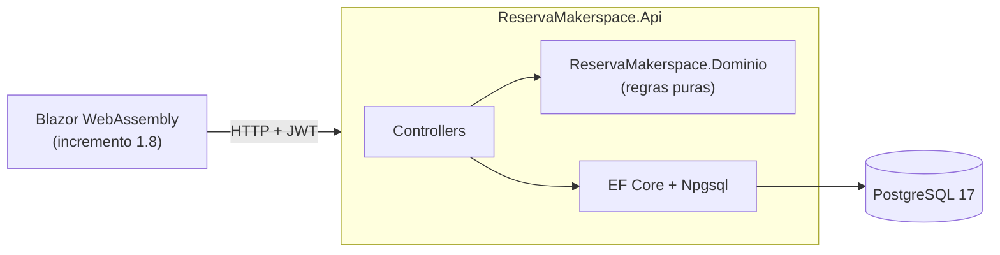

# Reserva de Equipamentos de Makerspace

Em parques tecnológicos como o Itec Park, onde trabalhei como bolsista, a cortadora a laser, as impressoras 3D e o scanner 3D ficam ocupados o dia inteiro. Com o controle em planilha, as reservas conflitam (há mais de uma máquina do mesmo tipo e ninguém sabe qual foi marcada), gente sem treinamento usa as máquinas e a manutenção não bloqueia a agenda.

Este projeto é uma API de reservas com regras claras e testadas (.NET 10, ASP.NET Core, EF Core e PostgreSQL), com uma interface em Blazor prevista para depois.

## Estado

Roteiro em `docs/specs/2026-11-24-c1-reserva-makerspace-design.md` (§9).

- **1.1 Esqueleto: concluído.** Solução, `Intervalo` (primeira regra do domínio), PostgreSQL com a primeira migração, `/saude`, erros em ProblemDetails, OpenAPI com Scalar, Docker, Compose e CI.
- 1.2 a 1.10: login e papéis, tipos e máquinas, treinamentos, reservas, desmarcação, manutenção, Blazor e deploy.

## Como rodar

Precisa do Docker.

```bash
cp .env.example .env
# edite o .env e defina POSTGRES_PASSWORD
docker compose up --build
```

- Saúde da API: <http://localhost:5080/saude> (200 `Healthy`, ou 503 se o banco cair)
- Documentação interativa: <http://localhost:5080/scalar> (o OpenAPI fica em `/openapi/v1.json`)
- PostgreSQL no host: porta `5433` (a `5432` fica livre para outro banco)

Sem a senha no `.env`, o Compose para com a mensagem "Defina POSTGRES_PASSWORD no .env".

## Como testar

```bash
dotnet test
```

Com o Docker aberto: os testes de integração sobem um PostgreSQL 17 real em container (Testcontainers). Os testes de unidade não usam Docker.

## Arquitetura



- `Dominio` guarda as regras (hoje, o `Intervalo` semiaberto) sem depender de banco nem de web, e por isso tem testes de unidade rápidos, sem Docker.
- `Api` expõe as rotas, aplica as migrations na subida e responde os erros em ProblemDetails, com títulos em português.
- `Testes.Integracao` sobe a API inteira (`WebApplicationFactory`) contra um PostgreSQL real em container.
- Os DTOs vão para um projeto `Contratos`, compartilhado com o Blazor, a partir do 1.2.

## Decisões

- [0001. Estrutura da solução](docs/decisoes/0001-estrutura-da-solucao.md)
- [0002. Migrations na subida da API](docs/decisoes/0002-migrations-na-subida-da-api.md)

## Roteiro de entrevista

- **Por que testar contra um PostgreSQL real, e não um banco em memória?** A primeira migração cria a extensão `btree_gist`, que é a base da restrição que vai impedir reservas sobrepostas no próprio banco. Um banco em memória não tem isso. O Testcontainers sobe o mesmo PostgreSQL 17 do Compose.
- **Por que o `Intervalo` é semiaberto e usa `DateTimeOffset`?** Uma reserva que termina às 10:00 não pode conflitar com outra que começa às 10:00. E a comparação é entre instantes, não entre relógios locais: um teste confere `10:00-03:00` contra `13:30Z`.
- **O que acontece quando falta configuração ou o banco cai?** Sem a connection string, a API não sobe e diz qual variável configurar. Com o banco fora do ar, `/saude` responde 503 em segundos. Sem a senha no `.env`, o Compose nem sobe o banco.
- **Por que não a Clean Architecture completa?** Neste tamanho de domínio, várias camadas só repassariam chamadas. Separei o que importa testar, que são as regras (ver o ADR 0001).
- **Aplicar migrations na subida não é arriscado?** Com uma instância, não. Com várias, a migração iria para um passo próprio do deploy (ver o ADR 0002).
- **Como os segredos ficam fora do repositório?** O `.env` é ignorado, o `.env.example` vai sem senha, a API recebe a senha por variável de ambiente, e a imagem roda com um usuário sem privilégio.

## Próximos passos

- 1.2: login e papéis (ASP.NET Core Identity + JWT), com 401 e 403 testados por rota.

## Como foi feito

Desenvolvido com apoio de ferramentas de IA, com as decisões e a revisão feitas por mim.
